# Salone Transport Hub (Flutter Mobile App) 🚗

A Flutter mobile application prototype designed to help people in Sierra Leone explore transportation options, compare fares, request rides and manage transportation activities.

**Project Domain:** Transportation and Public Services  
**Framework:** Flutter  
**Programming Language:** Dart  
**Course:** PROG 202 – Software Engineering, Assignment 2

---

## Project Description

Salone Transport Hub is a Flutter mobile application prototype that helps people in Sierra Leone find transport fares, compare transport options and request a ride.

It is the Flutter stage of the Salone Transport Hub project and builds on the problem, requirements and system logic developed during Assignment 1, which involved a Dart console prototype.

The project falls under the **Transportation and Public Services** domain.

The application supports three main user roles:

- Passenger
- Driver
- Administrator

The app is a student prototype. It is not owned, approved or endorsed by any government body, union or transport operator, and it does not set or control any transport price.

## Problem Being Solved

Fares for okada, kekeh, taxi, poda-poda and bus in Freetown and the provinces are agreed through official channels and revised often. However, passengers do not always have a single, clear place to check the fare that applies to their journey.

This can lead to confusion and disagreements between passengers and drivers.

Visitors from overseas may experience additional difficulties because they are unfamiliar with local transport prices and currencies.

Salone Transport Hub aims to address these challenges by providing a central platform where passengers can explore transport fares, compare transportation options, request drivers and access relevant journey information.

## Objectives

The main objectives of the project are to:

1. Turn the Assignment 1 Dart prototype into a Flutter mobile application with at least 10 connected screens.
2. Use Flutter widgets, forms with validation, navigation, reusable widgets and a clean project structure.
3. Display fares clearly, including their fare type and source.
4. Support three user roles: Passenger, Driver and Administrator.
5. Provide an interface that works across different phone sizes and supports light and dark modes.
6. Help visitors from overseas by displaying prices in selected foreign currencies.

---

## Features

### Everyone

- Animated logo on start-up, with an option to skip.
- Custom application icon.
- Registration and login interfaces for passengers and drivers.
- Form validation for user inputs.
- Phone number checks for Sierra Leonean and international numbers.
- Rejection of made-up phone numbers such as `0000000000`.
- Country detection from international calling codes.
- Place search screen for pickup and destination selection.
- Custom pickup or destination entry when a place is not listed. The fare uses the nearest listed route point plus 3 km per custom location; this is an approximation, not live map routing.
- Fare list and side-by-side fare comparison for okada, kekeh, taxi, poda-poda and bus.
- Fare types and source information.
- Settings for light mode, dark mode, accent colour and currency.
- Restore defaults option.
- User-specific settings.
- Higher-contrast default light theme.
- Notifications with pull-to-refresh.

### Passenger

- Home dashboard with summary, quick actions and popular routes.
- Transportation request form.
- Vehicle type selection.
- Passenger and extra-seat selection.
- Live estimated fare display.
- Immediate or scheduled transportation requests.
- Payment currency selection.
- Ability to accept or reject a responding driver.
- Ability to cancel a request.
- Request status tracking.
- Driver information and profile viewing.
- Payment demonstration and receipt summary.

### Driver

- Driver home dashboard with verification status and trip summary.
- Incoming transportation requests.
- Requests matched to the driver's vehicle type.
- Request acceptance or rejection.
- Passenger payment currency information.
- Ability to mark a trip as completed.
- Driver profile and vehicle information.

### Administrator

- Dashboard showing items requiring attention.
- Key application statistics.
- Simple charts and expected payments by currency.
- Driver verification management.
- Driver profile viewing.
- Driver suspension and reinstatement.
- Review of application activities.

---

## Application Screenshots

The following screenshots demonstrate selected interfaces and important functionality across the application.

**Screenshot instructions:** Upload the images into `docs/screenshots/` in your GitHub repository. Replace each `PASTE_..._IMAGE_LINK_HERE` placeholder with the corresponding image path or GitHub image link.

## 1. Welcome Screen

Introduces Salone Transport Hub and provides access to login, account creation and fare browsing.

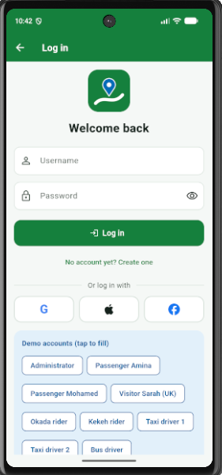

### 2. Login and Form Validation

Demonstrates the login interface, input fields and validation messages when required information is missing.

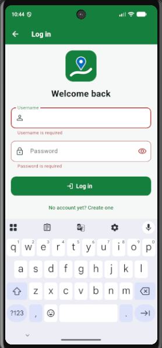

### 3. Driver Registration and Phone Validation

Shows the driver registration interface, vehicle information and phone number validation.

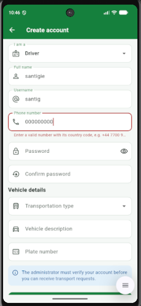

### 4. Passenger Home

The passenger dashboard displays a personalised greeting, trip information, vehicle options, quick actions and popular routes.

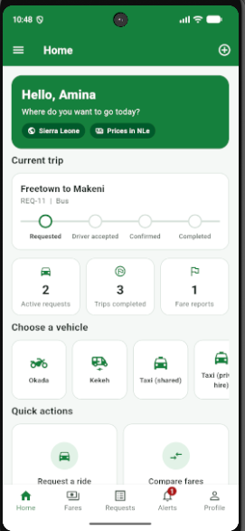

### 5. Place Search

Allows passengers to search and filter available places when selecting pickup and destination locations.

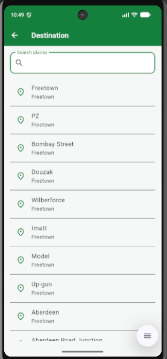

### 6. Fare Comparison

Displays estimated transportation fares side by side, including fare types and source information.

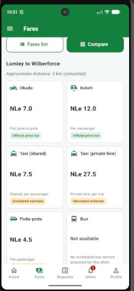

### 7. Transportation Request Form

Allows passengers to enter journey details, select a vehicle, specify the number of passengers and choose a preferred travel time.

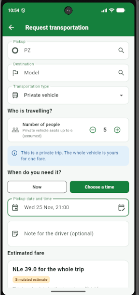

### 8. Request Status

Demonstrates how passengers can monitor transportation requests and identify their current statuses.

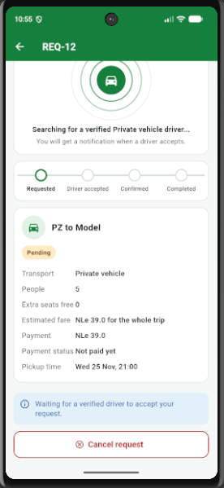

### 9. Driver Dashboard

Displays driver verification information, trip summaries and transportation request activities.

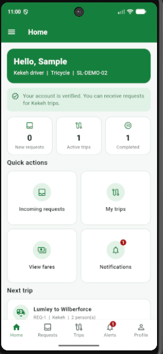

### 10. Administrator Dashboard

Provides an overview of passengers, requests, completed trips, expected payments and recent application activity.

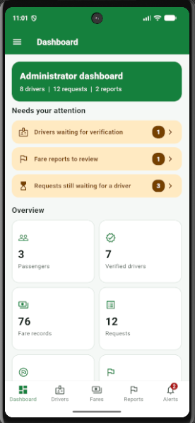

### 11. Driver Management

Demonstrates administrator functionality for reviewing driver accounts, verifying drivers and managing account access.

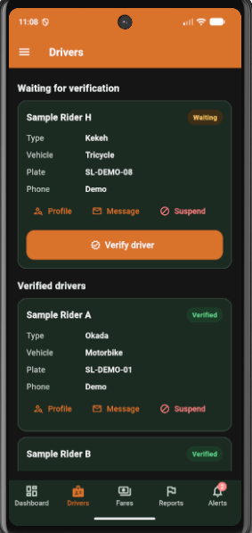

### 12. Settings and Dark Mode

Shows the application's appearance settings, including light and dark themes, accent colours and restore defaults.

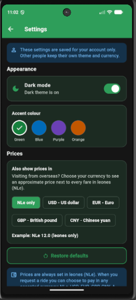

---

## Flutter Concepts Demonstrated

| Area             | What is Used                                                                                                      |
| ---------------- | ----------------------------------------------------------------------------------------------------------------- |
| UI               | Scaffold, AppBar, Text, Image.asset, Icons, Buttons, Container, Row, Column, Card, ListView and GridView          |
| Forms            | TextField, TextFormField, dropdowns, TextEditingController and form validation                                    |
| Navigation       | Navigator, named routes, navigation stack, passing data between screens, Bottom Navigation Bar, Drawer and TabBar |
| Architecture     | Reusable widgets, organised folders, separation of concerns, naming conventions and clean code                    |
| State Management | StatefulWidget, ChangeNotifier and application state updates                                                      |
| Theming          | ThemeData, light mode, dark mode and accent colours                                                               |
| Interaction      | Dialogs, notifications, buttons and user input handling                                                           |

---

## Getting Started (Clone and Run on a PC)

### 1. Install the Tools

| Tool           | Why                      | Link                                                                       |
| -------------- | ------------------------ | -------------------------------------------------------------------------- |
| Git            | To clone the project     | [Download Git](https://git-scm.com/downloads)                              |
| Flutter SDK    | To build the application | [Flutter Installation Guide](https://docs.flutter.dev/get-started/install) |
| Android Studio | Android SDK and emulator | [Download Android Studio](https://developer.android.com/studio)            |

In Android Studio, open Settings > Plugins and install the Flutter and Dart plugins.

Then check your setup in a terminal:

```bash
flutter doctor
```

Fix anything marked with a red cross. If it complains about Android licences, run:

```bash
flutter doctor --android-licenses
```

Accept the licences.

### 2. Clone the Project

Choose a simple folder such as `C:\Projects`.

Run:

```bash
git clone https://github.com/AKK041705/PROG202-ASSIGNMENT2-GROUP3-BSEM1101.git
```

Then:

```bash
cd PROG202-ASSIGNMENT2-GROUP3-BSEM1101
```

If `pubspec.yaml` is not in this folder, move into the subfolder that contains it.

### 3. Open It in Android Studio

1. Choose File > Open.
2. Select the project folder containing `pubspec.yaml`.
3. Click Get Dependencies when Android Studio displays the banner.

Alternatively, run:

```bash
flutter pub get
```

### 4. Start a Phone

**Emulator:**

1. Open Device Manager in Android Studio.
2. Click Create Device.
3. Choose a Pixel phone.
4. Select an Android system image.
5. Start the emulator.

**Real phone:**

1. Enable Developer Options.
2. Enable USB Debugging.
3. Connect the phone to your computer.
4. Accept the debugging permission prompt on the phone.

### 5. Run the App

Select your device from the toolbar and press the green Run button. Ensure the selected entry point is `main.dart`.

Alternatively, use the terminal:

```bash
flutter devices
flutter run
```

The first build may take a few minutes. The application opens with the animated logo, followed by the Welcome screen.

### Other Ways to Run

**VS Code:**

- Open the project folder.
- Install the Flutter extension.
- Select a device.
- Press F5.

**Android Studio:**

- Open the project folder containing `pubspec.yaml`.
- Make sure the Flutter and Dart plugins are installed.
- Select an Android emulator or connect a real Android device.
- Click the Run button to launch the application.

**Important:** This Flutter project can be developed and run independently in either Android Studio or Visual Studio Code. You do not need to use both IDEs at the same time. Both environments can run the application using the Flutter SDK.


**Chrome:**

If web support is configured, run:

```bash
flutter run -d chrome
```

---

## Troubleshooting

| Problem                                    | Fix                                                                                                                                    |
| ------------------------------------------ | -------------------------------------------------------------------------------------------------------------------------------------- |
| The emulator crashes or images do not show | Edit the emulator in Device Manager, set Graphics to Software and cold boot it. Alternatively, try `flutter run --no-enable-impeller`. |
| A build error occurs after pulling changes | Run `flutter clean`, then `flutter pub get`, followed by `flutter run`.                                                                |
| Flutter is not recognised                  | Add Flutter's `bin` folder to your PATH, then reopen the terminal.                                                                     |
| The old app icon still shows               | Uninstall the application from the emulator and run it again.                                                                          |
| You changed the icon image                 | Run `dart run flutter_launcher_icons`.                                                                                                 |

---

## Project Structure

The project follows an organised Flutter structure to separate application screens, models, data, services, state management and reusable widgets.

```text
lib/
│
├── main.dart              app entry point
│
├── core/                  colours, themes, routes, router,
│                          validators and preferences
│
├── models/                data classes (users, requests,
│                          reports, fares and notifications)
│
├── data/                  places, fare records and fare rules
│
├── services/              phone checks, country detection
│                          and currency conversion
│
├── state/                 AppState (in-memory data and actions)
│
├── widgets/               reusable cards, buttons, fields,
│                          tiles, navigation bar and logo
│
└── screens/                authentication, passenger,
                           driver, administrator and common screens

assets/
│
├── images/
│   └── logo.png           application logo
│
└── icon/                  application launcher icon images

docs/
└── screenshots/           application screenshots
```

---

## Demo Accounts

All accounts are fictional demonstration accounts.

| Role                    | Username         | Password   |
| ----------------------- | ---------------- | ---------- |
| Administrator           | `admin`          | `admin123` |
| Passenger               | `amina`          | `1234`     |
| Passenger               | `mohamed`        | `1234`     |
| Passenger (UK visitor)  | `sarah`          | `1234`     |
| Driver: Okada           | `rider1`         | `1234`     |
| Driver: Kekeh           | `kekeh1`         | `1234`     |
| Driver: Taxi            | `taxi1`, `taxi2` | `1234`     |
| Driver: Private vehicle | `van1`           | `1234`     |
| Driver: Poda-poda       | `poda1`          | `1234`     |
| Driver: Bus             | `bus1`           | `1234`     |

You can also create your own passenger or driver account on the Register screen.

New drivers must be verified by the administrator before they can receive transportation requests.

---

## Try the Full Flow

Follow these steps to explore the main application workflow.

1. Log in as `amina`.
2. Open Request a Ride.
3. Choose Kekeh from Lumley to Wilberforce.
4. Select 2 people and 1 extra seat.
5. View the estimated fare of NLe 36.0.
6. Under How Will You Pay?, try GBP or EUR to see the amount displayed in that currency.
7. Log out and log in as `kekeh1`.
8. Review and accept the transportation request.
9. Log out and log in as `amina` again.
10. Open the request and accept or reject the responding driver.
11. Log in as `admin` to explore driver verification, fare management, fare reports and expected payments by currency.
12. Open Settings and switch to dark mode or another accent colour.
13. Log in as another user to see that their settings are separate.

---

## Paying in Other Currencies

Prices in the application are always set in leones (NLe).

A passenger can choose to pay in:

- NLe
- USD
- EUR
- GBP
- CNY

The following rules apply:

1. The amount in the selected currency is calculated using indicative exchange rates and displayed before the request is sent.
2. A payment in another currency is recorded in that currency and is not converted back into leones by the application.
3. The administrator dashboard displays expected payments separately for each currency.
4. The prototype does not process real payments.

Accepting foreign currency in Sierra Leone must follow Bank of Sierra Leone rules, which should be checked before any real-world use.

---

## Phone Numbers and Countries

The application supports Sierra Leonean and international phone number formats.

Examples:

**Sierra Leone:**

- `076 123 456`
- `+232 76 123 456`

**International:**

- `+233 24 123 4567` (Ghana)
- `+44 7700 900123` (United Kingdom)

The country is detected from the international calling code. The application includes country detection for 128 countries, including all West African countries.

Visitors see prices in their currency when it is USD, EUR, GBP or CNY. Other countries use USD for display.

Numbers that appear to be made up, such as `0000000000` or `77000000`, are rejected.

---

## Fare Data

The application uses different fare information sources for demonstration and comparison.

**Official price list:**

- Kekeh routes.
- Provincial bus fares, using NLe 45.00 per litre.
- Okada and kekeh pole-to-pole fare of NLe 7, as supplied for this project.

**Published samples (news):**

- Selected poda-poda fares obtained from news reports.

**Simulated estimates:**

- Calculated by the application using an assumed distance and rate per kilometre.
- Used to demonstrate fare comparison where official fare information is unavailable.
- These estimates are not official transportation fares.

**Exchange rates:**

- Bank of Sierra Leone reference rates dated 5 June 2026.
- Indicative only and subject to daily changes.
- Configured in `lib/services/currency_service.dart`.

Always confirm fares with the latest official notice from the Ministry of Transport and Aviation.

---

## Privacy Considerations

- All demonstration accounts, drivers, vehicles, requests and reports use fictional sample data.
- Records stay in memory while the application runs and are not saved to an external production database.
- Passwords are kept as plain text in memory because this is a prototype.
- A production version will require secure authentication, appropriate password protection and proper data storage.

---

## Limitations and Next Steps

### Current Limitations

- **No production database:** Application data is not permanently saved and is lost when the application closes.
- **Authentication:** Login functionality is demonstration-based and is not connected to a production authentication service.
- **Simulated fares:** Some fares are estimates and are not official transportation prices.
- **Exchange rates:** Exchange rates are indicative and may change.
- **Payments:** No real payments are processed.
- **External integration:** The application is not connected to a government system, transport union, mobile money provider or live GPS service.
- **Social login:** Social login interfaces are demonstrations and require real authentication integration.

### Next Stage

Future improvements may include:

- Supabase database and authentication.
- Permanent storage of user and transportation records.
- Secure password handling.
- Maps and real-time location tracking.
- Real payment and mobile money integration.
- Push notifications.
- Improved reporting and analytics.

---

## GitHub Information

**Flutter Application – Assignment 2**

Repository:

https://github.com/AKK041705/PROG202-ASSIGNMENT2-GROUP3-BSEM1101

**Earlier Stage – Assignment 1 (Dart Console Prototype)**

Repository:

https://github.com/AKK041705/salone-transport-hub.git

---

## Author and Group

**Group 3 Members**

| No. | Name                        | Student ID |
| --- | --------------------------- | ---------- |
| 1   | Sabrina Kandeh              | 905005613  |
| 2   | Ibrahim E. Sesay            | 905005354  |
| 3   | Michael H. Coker            | 905005247  |
| 4   | Desmond Hinga Kutubu-Koroma | 905005702  |
| 5   | Abdul Karim Koroma          | 905005267  |

**Course:** PROG 202 – Software Engineering  
**Assignment:** Assignment 2 – Flutter Mobile Application  
**Examiner:** Santigie Foday Kamara  
**Institution:** Limkokwing University of Creative Technology, Sierra Leone Campus  
**GitHub:** AKK041705

---

**Salone Transport Hub**  
_Connecting passengers, drivers and transportation services through technology._
